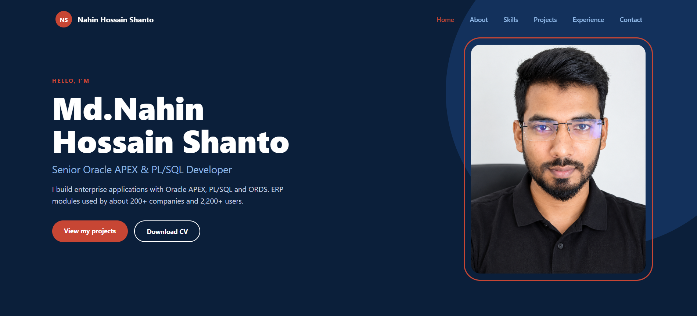

# Oracle APEX Portfolio

A personal portfolio website for **Md. Nahin Hossain Shanto**, Senior Oracle APEX Developer & Engineer, built entirely with **Oracle APEX** to show what the platform can do beyond internal business apps.

**Live site (Oracle APEX):** https://oracleapex.com/ords/r/nhs/portfolio/home
**GitHub Pages link:** https://nahinshanto.github.io/Oracle-APEX-Portfolio/

> The GitHub Pages address is a front door that points to the live APEX application. The portfolio itself runs on Oracle APEX.



---

## About this project

I wanted a portfolio that is itself proof of my work, so instead of using a website template I designed and built it as a real APEX application: custom HTML, CSS and JavaScript inside Static Content regions, with no plugins and no third-party framework.

## What's on the site

| Section | What it shows |
|---|---|
| **Home** | Hero with name, role, short pitch, profile photo, and a Download CV button |
| **About** | Short introduction and key numbers |
| **Skills** | Three service cards plus grouped skills: Oracle APEX, Database, Web & Integration, Reporting & Legacy |
| **Projects** | Three project cards linking to case studies |
| **Experience** | Timeline of roles, education, and my Oracle APEX Cloud Developer certification |
| **Contact** | Contact details and a form that sends by email or opens WhatsApp |
| **Case study pages** | One page each for the School Management System and the ISP Billing System: problem, what I built, tech used, and screenshots |

## Featured projects

- **School Management System:** Oracle APEX 24.2, 7 modules, 25 pages. Package-based PL/SQL, `APEX_JSON` Ajax callbacks, APEX Collections, and student photos stored as files through an Oracle Directory.
- **ISP Billing System:** payments, printable receipts, WhatsApp payment alerts through a browser-side AJAX bridge (the database server has no outbound internet), and role-based menu permissions with custom authentication and authorization schemes.
- **Enterprise ERP Suite:** modular ERP built at Dous IT covering HR and payroll, attendance and leave, production control, merchandising, inventory, accounts and supply chain.

> Images on the project and case study pages are **illustrations with sample data**. They do not show real client data or real customers.

## Tech stack

- **Oracle APEX 24.2** (Static Content regions, page aliases, public pages)
- **HTML, CSS, JavaScript** (custom responsive design, CSS Grid and Flexbox, smooth scrolling, scroll-aware menu)
- **Oracle REST Data Services (ORDS)** for friendly URLs
- **Static Application Files** for CSS, images, and the downloadable CV
- Hosted on **oracleapex.com** (free APEX evaluation service)

## How it's built

```
Application 180877 (alias: portfolio)
├── Page 1  home               Hero, About, Skills, Projects, Experience, Contact
├── Page 2  school-management  Case study
├── Page 3  isp-billing        Case study
└── Shared Components
    └── Static Application Files
        ├── portfolio.css      All styling (colour variables, layout, responsive rules)
        ├── profile.jpg, about.jpg, certificate.jpg, cv.pdf
        └── project1-3.jpg, cs1-*.jpg, cs2-*.jpg   Project and case study images
```

Some techniques used:

- Each section is a **Static Content** region using the *Blank with Attributes (No Grid)* template, so the page design is fully custom.
- Colours, spacing and fonts come from CSS variables (`--navy`, `--red`, `--sky`) in one stylesheet.
- A small script handles **smooth scrolling**, a **sticky menu**, and highlighting the section you're viewing.
- The contact form builds a `mailto:` message or a `wa.me` WhatsApp link, so no server-side code or database table is needed.
- Case study links use **page aliases** (`school-management`, `isp-billing`) for clean URLs.

## Run it yourself

1. Create a free workspace at [oracleapex.com](https://oracleapex.com) or use any Oracle APEX 24.x environment.
2. Create a new application, or import the exported application file if one is included in this repository.
3. Upload `portfolio.css` and your own images to **Shared Components → Static Application Files**.
4. Set every page to **Authentication: Page Is Public**.
5. Edit the text, links, email and WhatsApp number in the region HTML to make it yours.

## Notes

- The free APEX evaluation service is meant for demonstration and does not include backups, so keep an exported copy of the application.
- Replace the sample images with your own screenshots before reusing the design, and never show real client data.

## Contact

- **Email:** nahinhossain53@gmail.com
- **LinkedIn:** [linkedin.com/in/shanto-nahin](https://www.linkedin.com/in/shanto-nahin)
- **Location:** Dhaka, Bangladesh

Open to remote Oracle APEX and PL/SQL developer opportunities.
